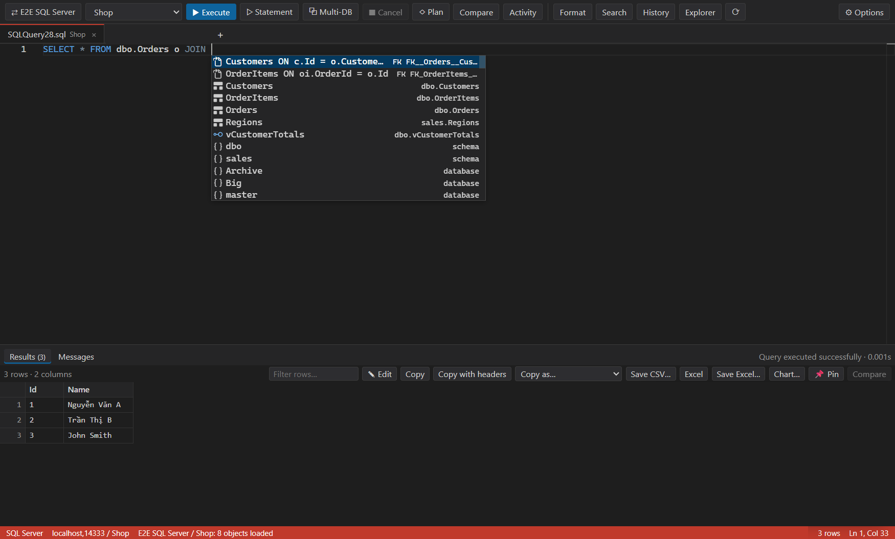
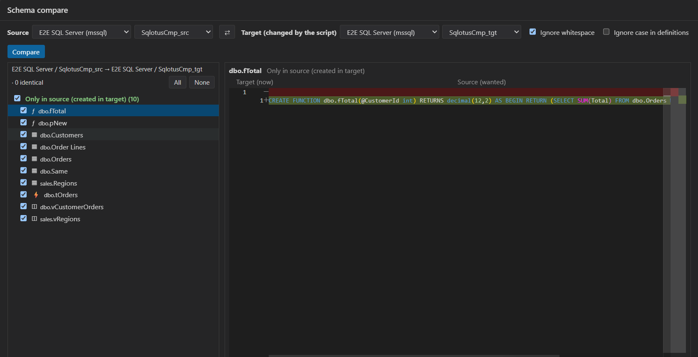
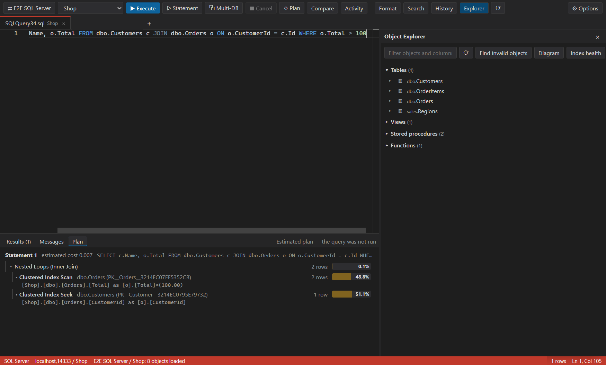
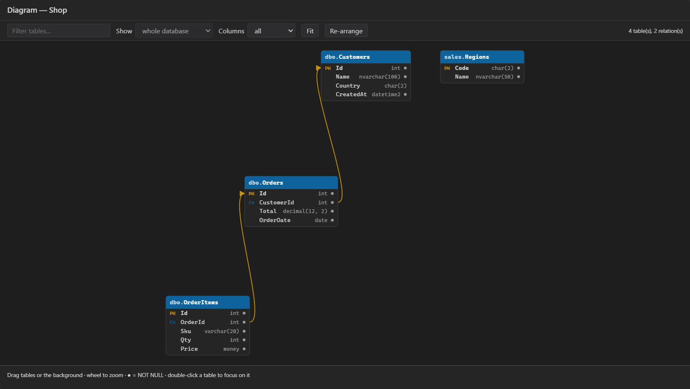

<div align="center">

**English** · [Tiếng Việt](docs/readme/README.vi.md)


# Sqlotus

### A fast desktop SQL editor for SQL Server, PostgreSQL and MySQL.

**Write queries faster, catch mistakes before they run, and understand your database — all on your own machine.**

[](https://github.com/tuancuongpham/Sqlotus/releases/latest)
[](https://github.com/tuancuongpham/Sqlotus/actions/workflows/ci.yml)
[](#quick-start)
[](#what-you-can-do)
[](#how-sqlotus-works)
[](LICENSE)



</div>

## Quick start

### Install

1. Download **`Sqlotus_<version>_x64-setup.exe`** from the [latest release](https://github.com/tuancuongpham/Sqlotus/releases/latest)
   (the `.msi` is for managed, machine-wide installs).
2. Run it — it installs per user and needs no administrator rights. Windows 11 already has the WebView2 runtime;
   on Windows 10 the setup installs it if it is missing.
3. The installers are not code-signed yet, so SmartScreen may warn: choose **More info → Run anyway**.
   `SHA256SUMS.txt` in the release lets you check the download.

### Connect

Click the connection button at the top left, pick **SQL Server**, **PostgreSQL** or **MySQL**, and enter the host,
port and login (SQL Server also offers Windows authentication). If the connection fails, the
**Connection Doctor** explains why and offers a fix.

### Try it

| Type or press | What happens |
|---|---|
| `SELECT * FROM dbo.Orders o JOIN ` | related tables are suggested together with the `ON` clause |
| `SELECT * FROM dbo.Orders`, cursor right after `*`, **Tab** | the `*` becomes the column list of the tables in `FROM` |
| **Ctrl+K, Ctrl+Y** | the script is formatted |
| **Ctrl+L** | estimated execution plan, without running the query |
| `UPDATE … ` without `WHERE`, then **F5** | Sqlotus asks before running it |

### Update

Run the newer installer. Connections, saved passwords, history and settings are kept.

## What you can do

| Area | Highlights |
|---|---|
| **Write SQL fast** | context-aware completion, foreign-key joins, `INSERT`/`EXEC` generation, wildcard expansion, snippets |
| **Format and refactor** | configurable formatter, qualify names, rename variables and aliases, go to definition |
| **Stay safe** | analysis while you type with a Problems list and quick fixes, confirmations for risky statements, read-only and production connections, open-transaction reminders |
| **Understand the database** | Object Search, Object Explorer, ER diagram, Used by, index health, activity monitor, schema compare |
| **Work as a team** | the schema in a git repository (commit, get latest, conflicts), the same analysis in CI with `sqlotus-lint` |
| **Work with results** | virtualized grid, edit rows, copy as INSERT/CSV/JSON/Markdown, Excel, charts, result compare, estimated plans |
| **Never lose a query** | every tab versioned automatically, full-text history, closed tabs reopened, tabs restored on restart |

Click a group for the details.

<details>
<summary><b>Writing SQL fast</b></summary>

- **Context-aware completion**: keywords, schemas, tables, views, columns, procedures and functions;
  understands aliases, CTEs, derived tables, `#temp` tables and `@table` variables; assigns table aliases
  automatically (`OrderDetails` → `od`).
- **Foreign-key joins**: after `JOIN` it suggests related tables together with the `ON` clause, and after
  `ON` the join condition.
- **Statement generation**:
  - pick a table after `INSERT INTO` → full column list plus a commented `VALUES` block
    (identity/computed/rowversion columns skipped, Tab jumps between values);
  - `EXEC proc` → one parameter per line with sample values, type comments and `(has default)`;
  - `GROUP BY` → the non-aggregated SELECT items.
- **Wildcard expansion**: with the `FROM` clause written, put the cursor right after `*` (or `t.*`) and press **Tab** to
  get the column list.
- **Cross-database completion**: `OtherDb.` → schemas, `OtherDb.dbo.` → objects, and columns of tables
  in other databases.
- **Hover** shows a table's columns, a column's type or a variable's type; **parameter hints** while typing
  function and procedure calls.
- **Snippets** with placeholders; import more from a folder of `.json` snippet files (Options → Snippets).

</details>

<details>
<summary><b>Formatting and refactoring</b></summary>

- **Format SQL** (Ctrl+K, Ctrl+Y): keyword case, aligned or stacked lists, leading/trailing
  commas, JOIN indentation, ON/AND/OR on new lines. The formatter verifies that only whitespace and keyword
  case changed.
- **Actions** (right-click or F1): expand wildcards, qualify object names, insert semicolons, remove square
  brackets, upper/lower-case keywords — each a single undoable edit.
- **Rename** (F2) a variable, table alias or CTE everywhere it is used.
- **Go to definition** (F12) and **Script as ALTER** (Alt+F12).

</details>

<details>
<summary><b>Safety and code analysis</b></summary>

- Squiggles while typing: UPDATE/DELETE without WHERE, `SELECT *`, `= NULL` comparisons, deprecated types,
  unused variables (also ones that are assigned but never read), unknown objects and columns, Unicode literals
  without the `N` prefix
  (`'Nguyễn'` would be stored as `Nguy?n`), `NOT IN (SELECT …)` over a nullable column, functions wrapped
  around a column in WHERE/ON (`YEAR(OrderDate) = 2024` cannot use an index), and comparisons that force an
  implicit conversion of the column (`varchar_col = N'x'`, `text_col = 123`).
- **Execution warnings**: confirmation before running UPDATE/DELETE without WHERE, TRUNCATE, DROP
  TABLE/DATABASE/SCHEMA and DROP COLUMN, and statements that reach other sessions or the server
  (`WITH ROLLBACK IMMEDIATE`, `SET OFFLINE`, `KILL`, `SHUTDOWN`).
- **Read-only connections**: block INSERT/UPDATE/DELETE/MERGE/DDL/GRANT/KILL on a connection (e.g. production)
  while still running queries; such tabs show a 🔒. On PostgreSQL and MySQL the session is read-only on the
  server too, so procedures and functions cannot write either. SQL Server has no read-only session: procedures
  called on it are not checked, so use a login with read-only permissions where it matters.
- **Open transaction reminder**: when a run leaves a transaction open (SQL Server, PostgreSQL, MySQL) the tab
  shows **TRAN**, the toolbar shows **Commit** / **Roll back**, and closing the tab asks what to do.
- **Confirm large changes**: scripts that only insert, update or delete rows run inside a transaction; if they
  change more rows than a limit (1,000 by default, Options → Safety) or fail half-way, Sqlotus asks whether to
  commit or roll back. Smaller changes are committed automatically and the row count is reported.
- **Manual commit** per connection: every change starts a transaction that stays open until you commit.
- **Undeclared variables**: running `… WHERE Id = @Id` without a `DECLARE` asks for the value (and type) and
  declares it for you; values are remembered.
- **Find invalid objects**: views, procedures, functions and triggers that reference missing tables or columns.
- **Problems** (tab next to Results): every problem of the tab with its rule and position; click to go there, group by
  rule or severity, filter, copy as a Markdown table. **Quick fixes** (Ctrl+. or Fix / Fix all): `= NULL` →
  `IS NULL`, add the `N` prefix, remove an unused declaration — Fix all is one undo step.
- **Rules**: switch rules off in Options → Analysis, or for one place with a comment:
  `-- sqlotus-disable-line SQ002`, `-- sqlotus-disable-next-line SQ001`, or `-- sqlotus-disable SQ005` …
  `-- sqlotus-enable` around a block. The light bulb adds the comment for you (above the line when the line ends
  inside a string).

</details>

<details>
<summary><b>Connection Doctor and notifications</b></summary>

- When a connection fails, the **Connection Doctor** explains why: server refused, timeout, unknown host or
  instance, login failed, certificate, database, Windows authentication. For a SQL Server on this computer it
  checks the service, TCP/IP, listening ports, SQL Server Browser and the authentication mode.
- One-click fixes: enable TCP/IP, start the service, start SQL Server Browser, enable SQL Server
  authentication (these ask Windows for administrator permission), use the right port or host, switch to
  Windows authentication, trust the certificate, pick another database, allow the port in Windows Firewall,
  enable a disabled login. It reconnects afterwards and reports the result.
- **Login failed (18456)** on a local server: the real reason is read from the Windows event log (wrong
  password, unknown login, disabled login, expired password, database unavailable). For remote servers it
  explains how to read the server's error log and what each state number means.
- **Check server** in the Connect dialog runs the same checks without an error, e.g. to let other computers
  connect (TCP/IP, firewall, SQL Server Browser).
- Every action and setting shows a notification: connecting, query finished (time and rows), errors with
  **Diagnose** / **Retry**, format and refactor, copy, CSV export, saving connections and options, restored tabs.

</details>

<details>
<summary><b>Search, history, explorer</b></summary>

- **Object Search** (Ctrl+Alt+D): find objects by name, column name or definition text in one or all databases,
  with a highlighted preview.
- **Query History** (Ctrl+Shift+H): every tab is versioned automatically (periodically and on each execute),
  full-text search, reopen closed tabs (Ctrl+Shift+T), diff against the previous version or the current tab.
  Open tabs are restored on restart.
- **Object Explorer** (F8, open by default): filter objects and columns, Select top 100, script
  SELECT/INSERT/UPDATE/DELETE/EXEC/CREATE/ALTER.
- **ER diagram**: tables and foreign keys of a database, or one table and its related tables, laid out
  automatically; drag, zoom, highlight relations, copy as image or save as SVG.
- **Used by**: views, procedures, functions, triggers and foreign keys that use a table, a column or a module,
  with the line — before you rename or drop something.
- **Schema compare** (toolbar → Compare): two databases on the same or different saved connections — tables
  (columns, types, NULL, defaults, identity, computed), primary keys, indexes, unique constraints, foreign keys,
  checks, views, procedures, functions and triggers, with a side-by-side diff per object. The sync script is
  ordered by dependencies (foreign keys dropped first and re-created last, missing schemas created), lists
  data-loss warnings at the top, and opens in a tab connected to the target — it is never run for you. Objects
  only in the target are not selected unless you choose to drop them. SQL Server requires VIEW DEFINITION:
  without it hidden objects would look missing, so the comparison refuses instead. Filter the list, open the
  identical objects, save a comparison to run it again, and export a report (HTML page or Markdown).
- **Index health**: missing indexes the server suggests, duplicate and overlapping indexes, indexes nobody reads,
  tables read by full scans and large heaps. Fixes are CREATE/DROP scripts opened in a tab, never run directly.
- **Test data**: realistic rows for a table (Vietnamese or English names, e-mails, phones, addresses, amounts,
  dates); foreign keys use rows that exist in the parent table and non-identity keys continue after the current
  maximum. The INSERT script opens in a new tab to review and run. E-mails use reserved example domains; phone
  numbers follow real formats and may belong to real people, so never send messages to them.

</details>

<details>
<summary><b>Source control (git)</b></summary>

Keep a database's schema in a folder — usually a git repository shared with your team (toolbar → Source control).

- Sqlotus writes one `.sql` file per table, view, procedure, function and trigger, for people and pull requests,
  and `sqlotus-schema.json`, the snapshot it compares with.
- Changes are sorted against the last state the database and the folder agreed on: **changes in the database**
  (commit them), **changes in the folder** (your team's: get them), and **conflicts** (both sides changed: keep
  the database version or take the folder version). A side-by-side diff shows each one.
- **Commit** writes the chosen objects into the folder and runs `git commit` on that folder only. **Get latest**
  builds a script for the chosen folder changes, between `Scripts/pre-deploy.sql` and `Scripts/post-deploy.sql`
  (data moves, renames), and opens it in a tab connected to the database — it is never run for you.
- **Pull**, **Push** and **History** run git in the folder; the first Push of a new branch publishes it to
  `origin`. A folder can only be linked when it is empty or already holds a Sqlotus schema, so a commit never
  takes other files with it; files edited by hand, and files git has not committed yet, are reported.
- Works the same for SQL Server, PostgreSQL and MySQL.

</details>

<details>
<summary><b>Running queries</b></summary>

- F5 / Ctrl+E runs the selection or the tab, Shift+F5 the statement at the cursor; `GO` / `GO n` batches;
  MySQL scripts with `DELIMITER` lines (dumps, procedures, triggers) run as the mysql client runs them; cancel;
  multiple result sets.
- **Run on multiple databases** (Ctrl+Shift+F5): every row gets a `Database` column; results with the same
  shape are combined.
- Virtualized result grid: sort by column, filter, copy (with headers), **copy as INSERT statements / CSV /
  IN (…) list**, save as CSV. Shift+click a range in a column to see Count / Sum / Avg / Min / Max.
- Values longer than 65,535 characters are shown cut: the grid says how many, copies and exports warn that they
  hold the cut text, and such a result cannot be edited. Query a long value on its own when you need all of it.
- **Excel**: open the result in Excel or save it as .xlsx (numbers stay numbers, header row, filters).
- **Chart**: bar, line or pie chart of a result; copy it as an image.
- **Compare results**: pin a result, run again (or another query), then compare — added, removed and changed
  rows matched on the key columns you choose.
- **Estimated execution plan** (Ctrl+L): a tree with the cost share of each step and warnings for scans that
  read a whole table, key lookups, implicit conversions, missing join predicates, plus missing-index
  suggestions with a ready CREATE INDEX statement. SQL Server, PostgreSQL and MySQL; the query is not run.
- **Edit rows** (✎ Edit on a result from one table with a primary key): change cells, add and delete rows, see the
  statements first; Save runs them in one transaction and keeps nothing if a row was changed by someone else meanwhile.
  On a production connection Save shows the statements and asks first.
- **Copy as** INSERT statements, CSV, IN (…) list, Markdown table, JSON or HTML table.
- **Activity monitor**: sessions, running queries, waits, open transactions and blocking chains (who blocks whom);
  cancel a query or kill a session after confirming. SQL Server, PostgreSQL and MySQL.
- **Environments**: mark connections Development / Test / Staging / Production. Production gets a red tab, a PROD
  badge, manual commit, and a confirmation naming the server before every statement that changes data or schema
  and before every procedure call (`EXEC` / `CALL`) — also on multiple databases and when saving edited rows.
- Per-connection tab colours. Passwords are stored in the Windows Credential Manager.

</details>

<details>
<summary><b>Keyboard shortcuts</b></summary>

| Keys | Action |
|---|---|
| F5 / Ctrl+E | Execute |
| Shift+F5 | Execute current statement |
| Ctrl+Shift+F5 | Run on multiple databases |
| Alt+Break | Cancel |
| Ctrl+L | Estimated execution plan |
| Ctrl+K, Ctrl+Y | Format |
| Tab after `*` | Expand to column list |
| F2 | Rename variable / alias / CTE |
| F12 / Alt+F12 | Go to definition / Script as ALTER |
| Ctrl+B, Ctrl+W | Expand wildcards |
| Ctrl+B, Ctrl+Q | Qualify object names |
| F8 | Object Explorer |
| Ctrl+Alt+D | Object Search |
| Ctrl+Shift+H | Query History |
| F1 | Command palette |
| Ctrl+N / Ctrl+W / Ctrl+Tab | New / close / next tab |
| Ctrl+Shift+T | Reopen closed tab |
| Ctrl+R | Toggle results |

</details>

## Command line: sqlotus-lint

The same rules, suppression comments and quick fixes for `.sql` files in a repository, for CI or a pre-commit
check. `sqlotus-lint.exe` comes with each release; on any system with Rust:
`cargo install --git https://github.com/tuancuongpham/Sqlotus sqlotus-cli --locked`.

```bash
sqlotus-lint --dialect mssql --fail-on warning sql/
```

| Option | |
|---|---|
| `--dialect mssql\|postgres\|mysql` | SQL dialect (default `mssql`, or the schema folder's) |
| `--schema <folder>` | a Sqlotus schema folder: also checks table and column names (SQ006, SQ007, SQ011) |
| `--disable SQ002,SQ005` | switch rules off |
| `--format text\|json\|github` | `github` prints annotations that GitHub Actions shows on the pull request |
| `--fail-on error\|warning\|info\|never` | exit code 1 when a problem at this level or above is found (default `warning`) |
| `--fix` | apply the safe quick fixes in place, then report what is left |
| `--list-rules` | the rules and what they need |

Files are read as UTF-8 or UTF-16 with a BOM, and `--fix` writes them back the same way; a file in another
encoding is checked but never rewritten. Links to folders are not followed.

A GitHub Actions step, with the schema folder committed by Source control:

```yaml
- run: cargo install --git https://github.com/tuancuongpham/Sqlotus sqlotus-cli --locked
- run: sqlotus-lint --schema db/schema --format github sql/
```

## Screenshots

<table>
  <tr>
    <td width="50%"></td>
    <td width="50%"></td>
  </tr>
  <tr>
    <td align="center"><b>Schema compare</b> — review the differences, then get a dependency-ordered sync script</td>
    <td align="center"><b>Estimated plan</b> — the cost of each step and warnings, without running the query</td>
  </tr>
  <tr>
    <td width="50%"></td>
    <td width="50%"></td>
  </tr>
  <tr>
    <td align="center"><b>ER diagram</b> — a whole database or one table and its neighbours</td>
    <td align="center"><b>Completion</b> — joins with their <code>ON</code> clause from the foreign keys</td>
  </tr>
</table>

## How Sqlotus works

- **The SQL engine** (`crates/sqlotus-core`) is a pure-Rust library with no IO: a fault-tolerant tokenizer that
  copes with half-typed queries, the formatter, completion, code analysis, refactorings, plans, schema compare and
  the schema folder of Source control. `sqlotus-lint` (`crates/sqlotus-cli`) runs the same engine on the command line.
- **Drivers** (`crates/sqlotus-db`) talk to each server directly — tiberius for SQL Server, tokio-postgres and
  mysql_async — and load the metadata that completion and analysis use.
- **The app** is built with [Tauri 2](https://tauri.app): a small native Rust backend with a React + Monaco
  interface. The installer is under 10 MB.
- **Everything stays local**: connections, history and settings live in a SQLite file on your computer and
  passwords in the Windows Credential Manager.

## FAQ

<details>
<summary><b>Is Sqlotus free?</b></summary>

Yes. It is open source under the MIT license, with no account, subscription or paid edition.
</details>

<details>
<summary><b>Does it send my data or queries anywhere?</b></summary>

No. Sqlotus has no telemetry and talks only to the database servers you connect to. See the
[security policy](.github/SECURITY.md) for how data is stored.
</details>

<details>
<summary><b>Can it change my data without asking?</b></summary>

No. Generated scripts (sync scripts, index fixes, test data, edited rows) open for review and are never run for
you. Statements without `WHERE`, `TRUNCATE`, `DROP TABLE` and `DROP COLUMN` ask first, scripts that change many rows
ask before committing, and production connections confirm every change and procedure call. Changes made inside a
procedure or function cannot be seen in the script, so on SQL Server use a read-only login for databases you only
read.
</details>

<details>
<summary><b>Which database versions are supported?</b></summary>

The tests run against SQL Server 2022, PostgreSQL 17 and MySQL 8.4. Older versions usually work. MariaDB connects
as MySQL and should work too, but it is not tested yet. If something does not work, please
[open an issue](https://github.com/tuancuongpham/Sqlotus/issues).
</details>

<details>
<summary><b>Does it replace my database's administration tools?</b></summary>

No. Sqlotus focuses on writing, running and understanding SQL. Server administration — backups, jobs, users and
permissions — stays in the tools made for it.
</details>

<details>
<summary><b>Does it run on macOS or Linux?</b></summary>

Not yet. Windows authentication and the Connection Doctor use Windows APIs; the rest is portable, so other
platforms are possible later.
</details>

<details>
<summary><b>Can I import my own snippets?</b></summary>

Yes. **Options → Snippets → Import snippets…** reads a folder of `.json` files, one snippet each, with `prefix`,
`description`, `body` (using `$name$` placeholders and `$CURSOR$`) and `placeholders`.
</details>

## Known limitations

- SQL Server: `PRINT` messages are not shown yet, and changed-row counts only for scripts that just change rows
  (the tiberius driver does not expose them for other batches).
- Schema compare treats a renamed column or table as drop + add, and leaves identity / computed column changes
  to be done by hand. Source control works the same way: use `Scripts/pre-deploy.sql` for renames and data moves.
- Source control keeps the schema, not table data, and compares its snapshot: change the database and commit,
  rather than editing the `.sql` files by hand.
- Windows only for now.
- Named-pipe connections (LocalDB) are not supported; use TCP.
- Test data does not read CHECK or UNIQUE constraints: a value may break a CHECK rule or repeat in a UNIQUE column
  (codes and e-mails differ per row, other values may not). Review the script before you run it.

## Development

Requirements: Windows 10/11, Rust (MSVC toolchain), Node 22+ and Visual Studio Build Tools (C++).

```bash
npm install
npx tauri dev
```

[CONTRIBUTING.md](.github/CONTRIBUTING.md) covers the project layout, the checks to run before a pull request,
and testing against real databases in Docker. Changes are listed in [CHANGELOG.md](CHANGELOG.md).

## Disclaimer

Sqlotus is provided as is, without warranty. Review generated scripts before you run them, especially against
production databases.

SQL Server is a trademark of Microsoft, MySQL of Oracle, and PostgreSQL of the PostgreSQL Community Association.
They are named only to say which databases Sqlotus connects to; Sqlotus is an independent project and is not
affiliated with or endorsed by any of them.

## Contributing

Bug reports, ideas and pull requests are welcome — see [CONTRIBUTING.md](.github/CONTRIBUTING.md) and the
[Code of Conduct](.github/CODE_OF_CONDUCT.md). Please report security problems privately as described in
[SECURITY.md](.github/SECURITY.md).

## License

[MIT](LICENSE). Sqlotus is built on open-source crates and npm packages; their licenses are collected in
[licenses/THIRD_PARTY_LICENSES.md](licenses/THIRD_PARTY_LICENSES.md) and installed with the app.
